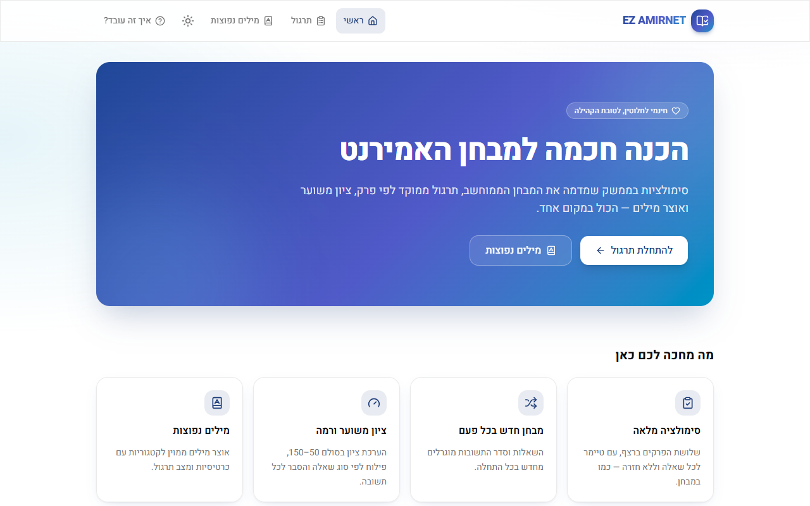
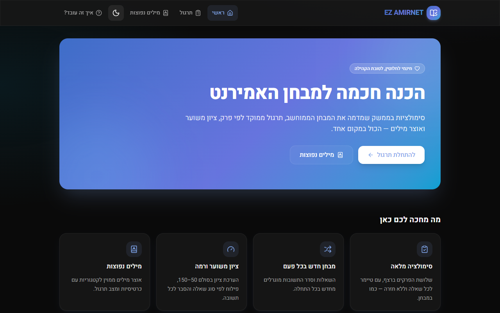
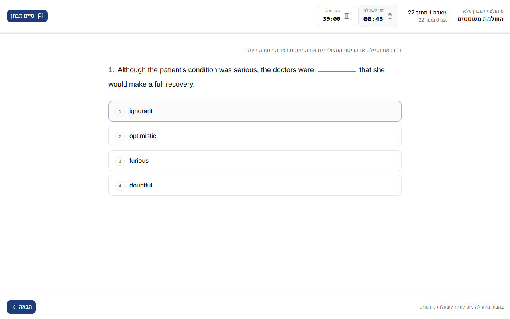
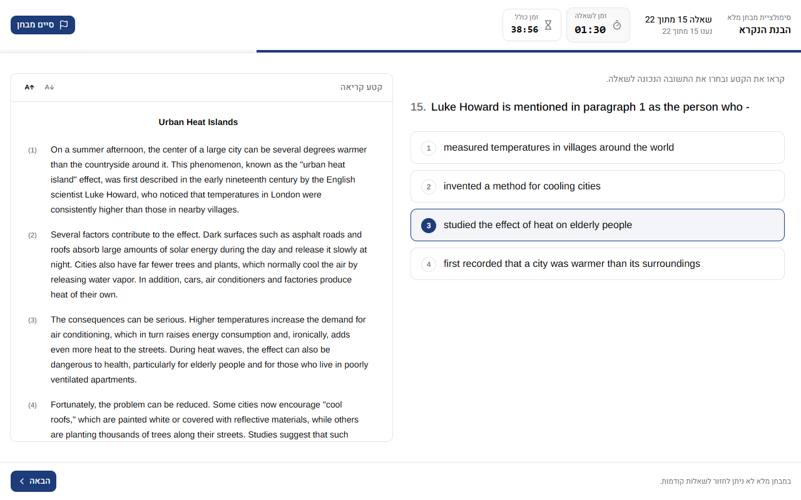
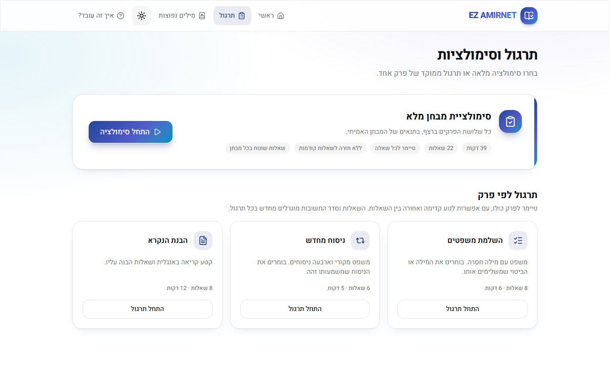
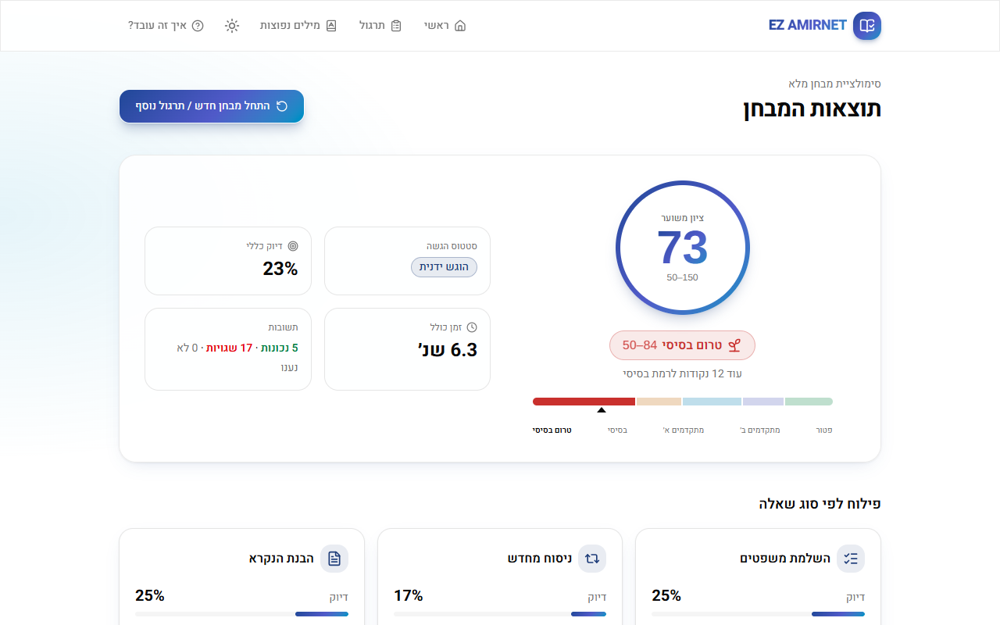
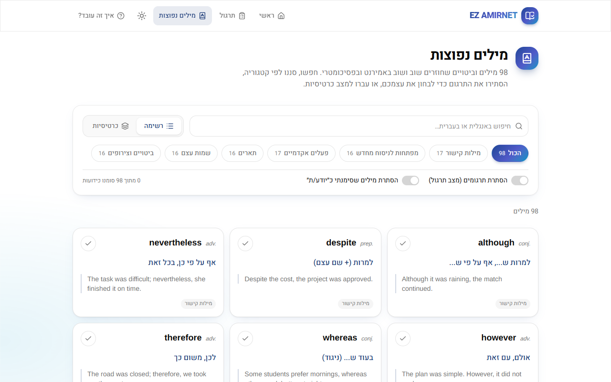
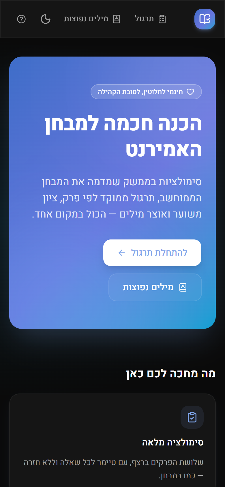

<div align="center">

# EZ AMIRNET

**A free exam-simulation platform for the Israeli Amirnet English test.**

[**Live Demo →**](https://www.amirnet-150.com)

[](https://nextjs.org)
[](https://www.typescriptlang.org)
[](https://tailwindcss.com)
[](https://zustand.docs.pmnd.rs)
[](https://vercel.com)

[English](#english) · [עברית](#hebrew)

</div>

---

<a id="english"></a>

## Executive Summary

**EZ AMIRNET** is a full-featured practice platform for the **Amirnet**, the computerized English placement test that Israeli universities and colleges use to set students' English level. It reproduces the structure, question formats, and timing rules of the real test in a fully right-to-left Hebrew interface, while keeping all English exam content strictly left-to-right.

The project started from a simple need: good Amirnet practice material is usually paid, scattered, or doesn't look like the real test. EZ AMIRNET is **100% free**, needs no sign-up, and runs entirely in the browser.

## Key Features

| | Feature | Details |
|---|---|---|
| 🧠 | **Full Exam Engine** | Three sections in a fixed order (Sentence Completion → Restatement → Reading Comprehension), a 39-minute overall limit, a per-question countdown, automatic advance when time runs out, and no going back, like the real test. |
| ⏱️ | **Dynamic Timer with Drift Prevention** | Time is computed from absolute deadlines, not by counting ticks, so a throttled background tab or a slow device never adds time. The clock catches up as soon as the tab becomes visible again. |
| 🎯 | **Practice Modes** | Practice one section with a section-level timer and free back/forward navigation. |
| 🔀 | **Randomized Exams** | Every new exam samples different questions per section and shuffles the answer order, remapping the correct answer and per-option explanations to match. |
| ♻️ | **No Repeats** | The browser remembers which questions and passages you've already seen, and new exams draw unseen ones first. A section's pool starts over only once you've seen all of it. |
| 🌗 | **Day / Night Mode** | A header toggle switches between light and dark themes. It follows the OS setting by default, remembers your choice, and applies it before first paint (no flash). |
| 📚 | **Large Question Bank** | 82 sentence-completion, 70 restatement, and 17 reading passages (68 questions), each with a Hebrew explanation. |
| 🃏 | **Vocabulary Flashcards** | About 100 high-frequency words in six categories, with search (English and Hebrew), category filters, a hide-translation self-test mode, 3D flip cards with keyboard navigation, and "known word" tracking. |
| 📊 | **Scoring Algorithm (50–150)** | Raw score → estimated Amirnet score → exemption level (Pre-Basic … Exempt), plus a difficulty-weighted variant. The scoring functions are pure, typed, and independent of the UI. |
| 🔍 | **Detailed Review Dashboard** | Score ring and level badge, a per-section accuracy and time breakdown, and a question-by-question review showing your answer, the correct answer, and a Hebrew explanation. |
| 👋 | **Onboarding** | A first-visit welcome modal (stored in `localStorage`) that can be reopened from the header at any time. |

## Technical Highlights

- **App Router architecture.** Content pages (`/`, `/practice`, `/vocabulary`) share a route-group layout with the header and footer, while `/exam` renders full-screen without site chrome, as on the real test. Every route is statically prerendered.
- **Custom Zustand hooks with `sessionStorage` persistence.** The exam store uses `persist` + `partialize` to save only a **compact exam layout** (question IDs and answer order), not full question objects. On reload, `materializeLayout` rebuilds the exam and checks it, so a refresh resumes the *same* exam, and a stale or tampered save is discarded instead of crashing. A `useSyncExternalStore`-based `useExamHydration` hook gates the UI until restore is complete, which prevents hydration mismatches and keeps a late restore from overwriting a newly started exam.
- **Strict RTL/LTR separation.** The document is `dir="rtl"` Hebrew (Heebo). All English exam material goes through a single `<EnglishContent>` primitive that applies `dir="ltr"`, `lang="en"`, and an Arial-metric exam font (Arimo). Layout uses logical properties (`ps-*`, `start-*`, `border-s`), so nothing is hard-coded to a direction.
- **Drift-free timer loop.** `useExamTimer` drives a 250 ms interval plus a `visibilitychange` listener. Each tick passes `Date.now()` to a pure store reducer that compares it with stored deadlines. The interval only controls how often the display refreshes; timing accuracy never depends on it.
- **Build-time data validation.** `data/questions.json` is checked when the module loads (schema, four options, valid answer index, unique IDs, passage linkage), so a malformed question **fails `next build`** instead of breaking an exam in production.
- **Deterministic randomness.** The exam builder accepts an injectable RNG (seeded mulberry32 available), which makes exam generation reproducible for debugging and testing.
- **Accessible by default.** Radix primitives for dialogs, `aria-*` progress bars, `aria-pressed` toggles, visible focus rings, 40px+ touch targets, and `prefers-reduced-motion` support.

### Architecture at a glance

```
app/
  (site)/              Home · Practice · Vocabulary   (header + footer layout)
  exam/                Full-screen exam runner · results/
components/
  exam/                Question card, passage panel, timer, navigation
  results/             Score ring, level badges, review accordion
  vocabulary/          Search/filter explorer, flashcards
  onboarding/          WelcomeModal
lib/
  useExamStore.ts      Zustand store: state machine, persistence, timing
  exam-builder.ts      Sampling, option shuffling, serializable layouts
  scoring.ts           Raw → 50–150 → level (pure functions)
  question-bank.ts     Typed, validated access to questions.json
types/exam.ts          Domain model (discriminated unions per question type)
```

## Screenshots

### Home: light & dark mode

| Light | Dark |
|:---:|:---:|
|  |  |

### Exam experience

| Sentence Completion | Reading Comprehension |
|:---:|:---:|
|  |  |

### Practice, results & vocabulary

| Practice Dashboard | Results |
|:---:|:---:|
|  |  |
| **Vocabulary Flashcards** | **Mobile (dark)** |
|  |  |

## Local Development

**Requirements:** Node.js 20+ and npm.

```bash
git clone https://github.com/2wito/Amirnet150.git
cd Amirnet150
npm install
npm run dev
```

Then open <http://localhost:3000>.

| Script | Purpose |
|---|---|
| `npm run dev` | Dev server (Turbopack) |
| `npm run build` | Production build; also validates the question bank |
| `npm run start` | Serve the production build |
| `npm run lint` | ESLint |

**Adding questions:** add entries to `data/questions.json`. Each needs a unique `id`, exactly four `options`, a `correctOptionIndex` (0–3), and a Hebrew `explanation`. Reading-comprehension questions are nested inside their passage.

## Deploying to Vercel

The app is fully static and needs **no environment variables**.

1. Push the repository to GitHub.
2. In Vercel, choose **Add New → Project**, import the repo, and keep the auto-detected Next.js settings.
3. Click **Deploy**. Every push to `master` then ships to production, and every pull request gets its own preview URL.

From the CLI:

```bash
npm i -g vercel
vercel          # preview
vercel --prod   # production
```

---

<a id="hebrew"></a>

<div dir="rtl">

## על המיזם

**EZ AMIRNET** הוא אתר חינמי לתרגול לקראת מבחן **האמירנט**, מבחן המיון הממוחשב באנגלית של מוסדות ההשכלה הגבוהה בישראל. האתר מדמה את מבנה המבחן, סוגי השאלות והזמנים, בממשק עברי מלא שבו התוכן באנגלית מוצג משמאל לימין.

### מטרת האתר

לתת לכל אחד ואחת גישה חופשית לתרגול איכותי שמדמה את מבנה המבחן, בלי תשלום ובלי הרשמה:

- **סימולציה מלאה** של 39 דקות עם טיימר לכל שאלה.
- **תרגול ממוקד** לפי פרק: השלמת משפטים, ניסוח מחדש והבנת הנקרא.
- **ציון משוער** בסולם 50–150 ותחקיר מפורט עם הסבר בעברית לכל שאלה.
- **אוצר מילים נפוץ** עם כרטיסיות, חיפוש וסינון.
- **מאגר גדול בלי חזרות**: מעל 200 שאלות, והאתר זוכר מה כבר ראיתם כדי להציג קודם שאלות חדשות.
- **מצב יום ולילה** בלחיצת כפתור.

### הבהרה משפטית ושחרור מאחריות

- כל חומרי התרגול, השאלות והערכות הציון באתר נועדו **להערכה עצמית בלבד**, ואין בהם משום ייעוץ לימודי רשמי, ציון מחייב או הכנה רשמית למבחן. הציון באתר הוא הערכה בלבד: המבחן האמיתי מותאם לנבחן ומחושב בשיטה אחרת.
- האתר **עצמאי לחלוטין** ואינו קשור, מטעם או בשיתוף עם המרכז הארצי לבחינות ולהערכה (מאל״ו), מכון נועם או כל מכון רשמי אחר להכנה למבחנים.
- **השימוש באתר ובחומרים הינו על אחריות המשתמש בלבד.**
- כל זכויות היוצרים של צדדים שלישיים שייכות לבעליהן. נתקלתם בתוכן שמפר זכויות יוצרים? כתבו ל-<span dir="ltr">[itay2wito@gmail.com](mailto:itay2wito@gmail.com)</span> והתוכן יוסר מיד.
- תנאי השימוש, מדיניות הפרטיות והצהרת הנגישות המלאים מופיעים בעמוד [המידע המשפטי](https://www.amirnet-150.com/legal) באתר.

### קרדיטים

**פיתוח, עיצוב ותוכן:** איתי טויטו (Itay Twito)<br>
**יצירת קשר:** <span dir="ltr">[itay2wito@gmail.com](mailto:itay2wito@gmail.com)</span>

</div>

---

<div align="center">

Designed & developed by **Itay Twito** · Free for the community

</div>
